## 👋 Привет!

Я **Napster** — делаю удобные программы для Windows и Android и браузерные 3D-игры.
Всё, что лежит в открытом доступе, можно скачать и пользоваться бесплатно.

 

## 🛠 Мои программы

<table><tr>
<td width="50%" valign="top">

### [🔍 DriverScout](https://github.com/NapsterFO/DriverScout)
  

Находит и обновляет драйверы Windows из официальных источников: Windows Update, NVIDIA, AMD, ASUS, Lenovo, HP, Dell. Вкладка для геймеров с установкой Steam, Discord и утилит производителей, проверка BIOS.

</td>
<td width="50%" valign="top">

### [🛡 Hidden Path](https://github.com/NapsterFO/HiddenPath)
  

Обход блокировок для Windows в одном окне: zapret, свой VLESS-сервер на Xray и прокси для Telegram.

</td>
</tr>
<tr>
<td colspan="2" valign="top">

### [👁 Blindspot](https://github.com/NapsterFO/Blindspot)
  

Обход блокировок для Android в одну кнопку: YouTube и Discord через ByeDPI без сервера, свой VLESS-сервер на Xray для нужных сайтов, российские сайты напрямую. Плитка в шторке, светлая и тёмная тема.

</td>
</tr></table>

## 🎮 Мои игры

| Игра | О чём |
|---|---|
| **Чертог Шипов** | 3D-рогалик: подземелья, лут и боссы |
| **Автобаттлер HoMM3** | 9 фракций, 126 существ, 30 заклинаний, поход на 100 уровней |
| **Rune Clash 3D** | битвы рунами в 3D |
| **Jade Serpent** | 3D-шарикострел в духе Zuma на three.js |
| **FON** | хоррор для ПК и телефонов |
| **Merge Cabinet** | головоломка на слияние предметов |
| **Змейка 3D** | классика в трёх измерениях |
| **Чебурек Кликер 3D** | кликер со вкусом |
| **Golden Slots Deluxe** | HTML5-слоты |

## ⚙️ На чём пишу

## 🔥 Активность

